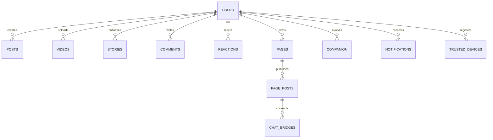
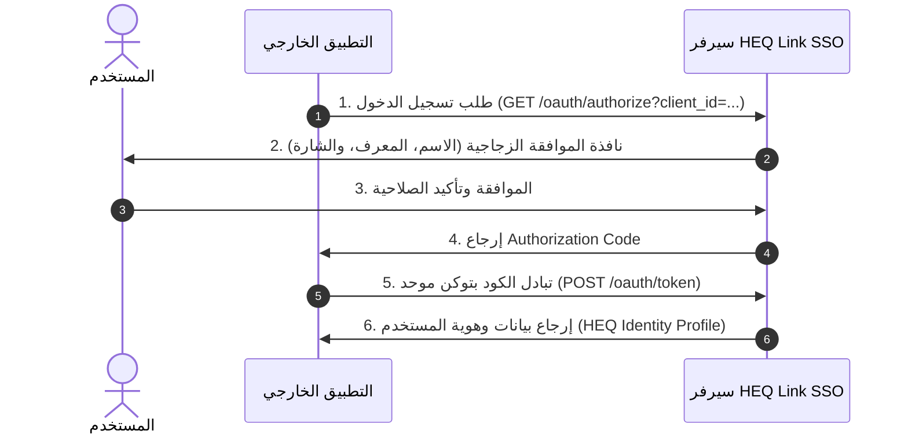

# 📘 وثيقة الهوية المعمارية ونظام التصميم الشامل لمنصة HEQ Link
## (HEQ Link Master Architecture, Design System & APIs Specification)

> ### 📌 الوظائف والمهام الأساسية لهذا الملف (File Functions & Scope):
> * **توحيد الهوية البصرية والنظام الزجاجي (Glassmorphism):** تفصيل لوحة الألوان، الخطوط، وتأثيرات الزجاج المصنفر في فلاتر والويب.
> * **معمارية قواعد البيانات والخدمات الخلفية:** مخططات الجداول العلائقية (PostgreSQL)، ونقاط الاتصال البرمجية (RESTful & WebSockets).
> * **نظام الإعدادات والتحكم الشامل:** إعدادات الأمان (2FA)، وضع الشبح، والمظهر، ونظام النوافذ المنبثقة والقوائم السفلية (Modals).
> * **الفئة المستهدفة:** مهندسو التصميم (UI/UX)، مهندسو Flutter، مهندسو الواجهة الخلفية، ونماذج الذكاء الاصطناعي المطورة لمنظومة HEQ.

---

```
========================================================================================
                                H E Q   L I N K
             Visual Identity • Glassmorphism • Architecture • APIs • Settings
========================================================================================
```

---

# 📑 فهرس المحتويات (Table of Contents)

1. [الباب الأول: الهوية البصرية ونظام واجهات المستخدم (Visual Identity & UI System)](#الباب-الأول-الهوية-البصرية-ونظام-واجهات-المستخدم)
   * 1.1 لوحة الألوان الرقمية الشاملة (HEX, RGB, HSL)
   * 1.2 الخطوط ونظام الطباعة (Typography Hierarchy)
   * 1.3 نظام تعدد اللغات والتعريب (Localization & Multi-Language)
   * 1.4 نظام الأيقونات والوسائط السحابية (SVG Icons & Cloud CDN)
2. [الباب الثاني: هندسة الزجاج المصنفر والمؤثرات البصرية (Frosted Glass & Glassmorphism)](#الباب-الثاني-هندسة-الزجاج-المصنفر-والمؤثرات-البصرية)
   * 2.1 المبادئ البصرية والرياضية للزجاج المصنفر
   * 2.2 مكون الزجاج في فلاتر (`GlassContainer` & `StandardBottomSheet`)
   * 2.3 مكونات الزجاج في الويب والـ CSS (`.glass-card`, `.glass-button`)
3. [الباب الثالث: هيكلة الباك إند وقواعد البيانات (Backend & DB Architecture)](#الباب-الثالث-هيكلة-الباك-إند-وقواعد-البيانات)
   * 3.1 مخطط الجداول وقاعدة البيانات العلائقية (Relational Schemas)
   * 3.2 كتالوج نقاط الاتصال البرمجية (RESTful & WebSocket APIs)
4. [الباب الرابع: نظام الإعدادات والتحكم الشامل (Comprehensive Settings Architecture)](#الباب-الرابع-نظام-الإعدادات-والتحكم-الشامل)
   * 4.1 إعدادات الأمان والمصادقة والأجهزة النشطة
   * 4.2 إعدادات الخصوصية ووضع الشبح (Ghost Mode)
   * 4.3 إعدادات المظهر والخطوط ومقاييس الشاشة
   * 4.4 إعدادات الرفيق الذكي والإشعارات
   * 4.5 مسار حذف الحساب وفترة السماح
5. [الباب الخامس: نظام النوافذ المنبثقة والقوائم السفلية والحوارات (Popups & Modals System)](#الباب-الخامس-نظام-النوافذ-المنبثقة-والقوائم-السفلية-والحوارات)
   * 5.1 القوائم السفلية المعيارية (Bottom Sheets)
   * 5.2 صناديق الحوار والتأكيد (Dialogs & Alerts)
   * 5.3 نوافذ التحديثات والاستطلاعات والإشعارات اللحظية
6. [الباب السادس: خارطة طريق التحول إلى Flutter (Flutter Transition Plan)](#الباب-السادس-خارطة-طريق-التحول-إلى-flutter)
   * 6.1 مكتبة المكونات المتكررة (Reusable Custom Widgets)
   * 6.2 هيكلة الشاشات والتنقل والروابط العميقة (Navigation & Deep Links)
7. [الباب السابع: نظام المصادقة والتوسع المستقبلي (Auth, SSO & Scaling)](#الباب-السابع-نظام-المصادقة-والتوسع-المستقبلي)
   * 7.1 تهميش تسجيل الدخول وتفعيل وضع الزائر (Guest Mode)
   * 7.2 تسجيل الدخول الموحد (Continue with HEQ Link SSO)
   * 7.3 الميزات المستقبلية (بطاقة الصدقة، الأوسمة، البث الصوتي)

---

# الباب الأول: الهوية البصرية ونظام واجهات المستخدم

---

## 1.1 لوحة الألوان الرقمية الشاملة (Digital Color Palette)

تعتمد الهوية البصرية لمنصة **HEQ Link** على فلسفة التباين العالي مع الشفافية الرقمية، مع توحيد الأكواد اللونية في جميع المنصات (Flutter & React).

```
+-----------------------------------------------------------------------------------------------+
|  Cyan Primary     |  Pro+ Gold        |  Pro Crimson      |  Dark Canvas      | Light Canvas  |
|  #00D2FF          |  #FFD700          |  #D32F2F          |  #0A0A0A          | #F5F7FA       |
|  rgb(0, 210, 255) |  rgb(255, 215, 0) |  rgb(211, 47, 47) |  rgb(10, 10, 10)  | rgb(245..250) |
+-----------------------------------------------------------------------------------------------+
```

### أ. الألوان الأساسية والتدرجات (Brand Core & Gradients)

| اسم اللون / الرمز | الاستخدام الرئيسي | كود HEX | كود RGB | كود HSL |
| :--- | :--- | :--- | :--- | :--- |
| **HEQ Cyan (Primary)** | اللون المحوري للعلامة، الأزرار، التوهج، شارة التوثيق | `#00D2FF` | `rgb(0, 210, 255)` | `hsl(191, 100%, 50%)` |
| **HEQ Deep Blue** | تدرج الأزرار، الحواف النشطة، الروابط | `#0088FF` | `rgb(0, 136, 255)` | `hsl(208, 100%, 50%)` |
| **HEQ Azure Light** | خلفيات الأيقونات الخفيفة، التوهج المحيطي | `#40C4FF` | `rgb(64, 196, 255)` | `hsl(199, 100%, 63%)` |
| **HEQ Navy Accent** | تدرجات الأزرار العميقة، الحالات الداكنة | `#0091EA` | `rgb(0, 145, 234)` | `hsl(203, 100%, 46%)` |
| **Success Emerald** | حالات النجاح، إتمام المهام، التوثيق | `#10B981` | `rgb(16, 185, 129)` | `hsl(142, 76%, 36%)` |
| **Destructive Red** | حذف الحساب، الحظر، الأخطاء، البلاغات | `#EF4444` | `rgb(239, 68, 68)` | `hsl(0, 84%, 60%)` |
| **Warning Amber** | التحذيرات، انتهاء الجلسة، قفل الأجهزة | `#F59E0B` | `rgb(245, 158, 11)` | `hsl(45, 93%, 47%)` |

---

### ب. ألوان الشارات والعضويات الرسمية (Badges & Membership System)

| الشارة / العضوية | اللون الأساسي (HEX) | لون التدرج الثانوي (HEX) | مسار الأيقونة المعتمدة | المعنى البرمجي |
| :--- | :--- | :--- | :--- | :--- |
| **Verified (الزرقاء)** | `#00D2FF` | `#0091EA` | `assets/icons/verified_rounded.svg` | شارة التوثيق والأصالة الرسمية للحسابات |
| **Pro+ (الذهبية)** | `#FFD700` | `#FFF176` | `assets/icons/workspace_premium.svg` | عضوية Pro+ الذهبية (الذكاء الاصطناعي ومضاعفة الشعلات) |
| **Pro (الحمراء)** | `#D32F2F` | `#FFC107` | `assets/icons/admin_panel_settings.svg` | عضوية Pro المتقدمة للأدوات والإحصائيات |
| **Admin (الإدارة)** | `#FFD700` | `#F57F17` | `assets/icons/verified_user_rounded.svg` | شارة طاقم إدارة وتشغيل منصة HEQ Link |
| **Suspended / Disabled** | `#EF4444` | `#991B1B` | `assets/icons/gpp_bad_rounded.svg` | الحسابات الموقوفة أو المخالفة |
| **Scheduled Deletion** | `#FF9800` | `#E65100` | `assets/icons/history_toggle_off_rounded.svg` | الحسابات في فترة السماح (14 يوم) |

---

### ج. ألوان نظام الشعلات والرتب (Flames & Ranks Palette)

| الرتبة / العنصر | الاسم الرسمي | الرمز | كود HEX | كود التدرج اللوني |
| :--- | :--- | :---: | :--- | :--- |
| **Flame Lvl 1** | شعلة البداية | 🔥 | `#FF9800` | `#FF9800` → `#F57C00` |
| **Flame Lvl 2** | شعلة الاستمرار | 🔥 | `#FF5722` (مع 2% Blue Tint) | `#FF5722` → `#E64A19` |
| **Flame Lvl 3** | شعلة العطاء والالتزام | 🔥 | `#D84315` (مع 4% Blue Tint) | `#BF360C` → `#D84315` |
| **Rank 1** | ✨ مبادر (Rank 1) | ✨ | `#6D4C41` (Bronze) | `#3E2723` → `#5D4037` |
| **Rank 2** | ⭐ مثابر (Rank 2) | ⭐ | `#0288D1` (Sky Blue) | `#01579B` → `#0277BD` |
| **Rank 3** | 🌟 مجتهد (Rank 3) | 🌟 | `#FBC02D` (Gold Star) | `#F57F17` → `#FBC02D` |
| **Rank 4** | 👑 متميز (Rank 4) | 👑 | `#E64A19` (Fire Crown) | `#BF360C` → `#D84315` |
| **Rank 5** | 💎 قدوة (Rank 5) | 💎 | `#651FFF` (Royal Diamond) | `#311B92` → `#4527A0` |

---

### د. ألوان الخلفيات والأسطح (Surfaces & Glassmorphism Tokens)

* **الوضع الداكن (Dark Mode):**
  * `Scaffold Background`: `#0A0A0A` (Deep Cyber Black)
  * `Card Surface`: `#151515` (Slate Card)
  * `Surface Container Highest`: `#1E1E1E`
  * `Borders & Dividers`: `rgba(255, 255, 255, 0.10)`
  * `Text Primary`: `#FFFFFF`
  * `Text Secondary`: `rgba(255, 255, 255, 0.70)`
  * `Text Muted`: `rgba(255, 255, 255, 0.45)`

* **الوضع الفاتح (Light Mode):**
  * `Scaffold Background`: `#F5F7FA` (Clean Cool Grey)
  * `Card Surface`: `#FFFFFF` (Pure White)
  * `Borders & Dividers`: `#E2E8F0` (Subtle Slate Border)
  * `Text Primary`: `#000000` / `#0F172A`
  * `Text Secondary`: `rgba(0, 0, 0, 0.65)`
  * `Text Muted`: `rgba(0, 0, 0, 0.40)`

---

## 1.2 الخطوط ونظام الطباعة (Typography System)

تعتمد المنصة خطوطاً عصرية تدعم القراءة المريحة باللغتين العربية والإنجليزية مع الحفاظ على التناسق في الأحجام والأوزان.

```
       Aa  Tajawal (Arabic Main)      |   Aa  Work Sans / Inter (EN)
       Thin (300) Regular (400)       |   Medium (500) SemiBold (600)
       Bold (700) ExtraBold (800)     |   Black (900)
```

1. **الخط العربي الأساسي:** `Tajawal` (عبر `GoogleFonts.tajawal`) - الخط المعتمد لواجهات التطبيق والموقع.
2. **الخطوط البديلة المدعومة في إعدادات التطبيق:** `Cairo`, `Almarai`, `IBM Plex Sans Arabic`, `Noto Sans Arabic`, `Changa`, `Amiri`.
3. **الخطوط الإنجليزية / التقنية:** `Work Sans`, `Inter`, `Space Grotesk`, `Inconsolata` (للأكواد والبيانات الرقمية).

### السلم الطباعي المعتمد (Typography Scale):

| المستوى الطباعي | الحجم (Size) | الوزن (Weight) | ارتفاع السطر (Height) | الاستخدام |
| :--- | :--- | :--- | :--- | :--- |
| **Display / Hero** | `28px - 32px` | `FontWeight.w900` | `1.2` | بانرات الترحيب وعناوين الترويسة الكبرى |
| **Heading 1 (H1)** | `22px - 24px` | `FontWeight.w800` | `1.3` | عناوين الشاشات والصفحات الرئيسية |
| **Heading 2 (H2)** | `18px - 20px` | `FontWeight.w700` | `1.4` | عناوين الأقسام وتفاصيل الشارات |
| **Heading 3 (H3)** | `15px - 16px` | `FontWeight.w600` | `1.4` | عناوين البطاقات وأسماء المستخدمين |
| **Body Large** | `14px - 15px` | `FontWeight.w400` / `w500` | `1.6` | نصوص المنشورات والمقالات وسياسات الاستخدام |
| **Body Standard** | `13px - 13.5px` | `FontWeight.w400` | `1.5` | نصوص الوصف الفرعية والتعليقات |
| **Caption / Meta** | `11px - 12px` | `FontWeight.w500` / `w600` | `1.3` | التوقيت، عداد التفاعلات، الشارات النصية |
| **Tiny / Badges** | `9.5px - 10.5px` | `FontWeight.w700` | `1.2` | عداد الإشعارات، وسوم الحالة |

---

## 1.3 نظام تعدد اللغات والتعريب (Localization & Multi-Language)

تم بناء التطبيق بهيكلية ثلاثية اللغات (`ar`، `en`، `de`) تدعم التبديل اللحظي بدون إعادة تشغيل التطبيق مع مراعاة اتجاه النصوص (RTL / LTR).

```
                            [ App Language State ]
                                      |
              +-----------------------+-----------------------+
              |                       |                       |
        🇸🇦 Arabic (ar)          🇬🇧 English (en)        🇩🇪 German (de)
          (RTL Default)               (LTR)                   (LTR)
```

* **ملفات التوطين:** `lib/l10n/app_ar.arb` (2400+ مفتاح ترجمة مع المتغيرات مثل `{passed} من {total} يوم`)، `app_en.arb`، `app_de.arb`.
* **التخزين المحلي:** `SharedPreferences.setString('languageCode', code)`.
* **التبديل البرمجي:** `HajjenApp.setLocale(context, Locale(code))`.

---

## 1.4 نظام الأيقونات والوسائط السحابية (SVG & Cloud CDN Architecture)

### أ. أيقونات SVG المحلية (`assets/icons/` - أكثر من 180 أيقونة):
* جميع الأيقونات يتم تلوينها برمجياً عبر `ColorFilter.mode(color, BlendMode.srcIn)`.
* تصنيفات رئيسية: التوثيق والرتب، الشعلات والالتزام، التنقل والقوائم، الأمان والأجهزة، التفاعل والوسائط.

### ب. هيكلة استدعاء الوسائط السحابية (Cloud CDN Media Architecture):
بدلاً من حزم صور الكواكب والخلفيات الثقيلة محلياً، يتم استدعاؤها عبر روابط مباشرة سحابية (Cloudinary / S3 / HEQ Storage):

```dart
class HeqNetworkImage extends StatelessWidget {
  final String imageUrl;
  final double? width;
  final double? height;
  final BoxFit fit;

  const HeqNetworkImage({
    super.key,
    required this.imageUrl,
    this.width,
    this.height,
    this.fit = BoxFit.cover,
  });

  @override
  Widget build(BuildContext context) {
    if (imageUrl.startsWith('assets/')) {
      return Image.asset(imageUrl, width: width, height: height, fit: fit);
    }
    return CachedNetworkImage(
      imageUrl: imageUrl.startsWith('http') 
          ? imageUrl 
          : 'https://hajen-app.onrender.com$imageUrl',
      width: width,
      height: height,
      fit: fit,
      placeholder: (context, url) => Container(
        color: Colors.white.withOpacity(0.05),
        child: const Center(child: CircularProgressIndicator(strokeWidth: 2)),
      ),
      errorWidget: (context, url, error) => Container(
        color: Colors.white.withOpacity(0.05),
        child: const Icon(Icons.broken_image_rounded, color: Colors.grey, size: 24),
      ),
    );
  }
}
```

---

# الباب الثاني: هندسة الزجاج المصنفر والمؤثرات البصرية

---

## 2.1 المبادئ البصرية والرياضية للزجاج المصنفر (Frosted Glass Engineering)

يقوم نظام الزجاج المصنفر (Glassmorphism) في **HEQ Link** على 4 ركائز فيزيائية:

```
[ الخلفية الطبقية الأصلية ]
           │
┌──────────▼──────────┐
│  Backdrop Filter    │  ◄── Blur: SigmaX=25.0, SigmaY=25.0
├─────────────────────┤
│  Color Tint Layer   │  ◄── Dark: rgba(255,255,255, 0.08) | Light: rgba(255,255,255, 0.50)
├─────────────────────┤
│  Translucent Border │  ◄── Dark: rgba(255,255,255, 0.20) | Light: rgba(0,0,0, 0.10) (1.0px)
├─────────────────────┤
│  Soft Drop Shadow   │  ◄── Blur: 15px, Spread: 0, Color: rgba(0,0,0, 0.20)
└─────────────────────┘
```

1. **التمويه الضبابي (Gaussian Blur):** معامل تشتيت الضوء `sigmaX: 25.0`, `sigmaY: 25.0` لعزل المحتوى الخلفي دون فقدان إحساس الإضاءة والعمق.
2. **الشفافية المشبعة (Tint & Opacity):**
   * في الوضع الداكن: استخدام لون أبيض شفاف بنسبة `8%` إلى `10%` ليعكس الأسطح الزجاجية الباردة.
   * في الوضع الفاتح: استخدام لون أبيض شفاف بنسبة `50%` إلى `60%` لضمان وضوح النصوص والقراءة.
3. **الحدود العاكسة (Subtle Light Borders):** حدود بسماكة `1.0px` بلون أبيض شفاف `rgba(255, 255, 255, 0.20)` تحاكي انعكاس الضوء على حواف الزجاج المصقول.
4. **الظل السطحي الناعم (Ambient Shadow):** ظل ناعم بانتشار `15px` بلون أسود شفاف لرفع الحاوية عن الطبقة الخلفية.

---

## 2.2 مواصفات وتطبيق الزجاج في Flutter

### أ. ويدجت `GlassContainer` (`lib/widgets/glass_container.dart`):

```dart
class GlassContainer extends StatelessWidget {
  final Widget child;
  final double? width;
  final double? height;
  final EdgeInsetsGeometry? padding;
  final EdgeInsetsGeometry? margin;
  final double borderRadius;
  final bool isLight;
  final BoxBorder? border;
  final Color? color;

  const GlassContainer({
    Key? key,
    required this.child,
    this.width,
    this.height,
    this.padding,
    this.margin,
    this.borderRadius = 16.0,
    this.isLight = false,
    this.border,
    this.color,
  }) : super(key: key);

  @override
  Widget build(BuildContext context) {
    final Color backgroundColor = isLight 
        ? Colors.white.withOpacity(0.50) 
        : Colors.white.withOpacity(0.08);
        
    final Color borderColor = isLight 
        ? Colors.black.withOpacity(0.10) 
        : Colors.white.withOpacity(0.20);

    return Container(
      margin: margin,
      width: width,
      height: height == double.infinity ? null : height,
      decoration: BoxDecoration(
        borderRadius: BorderRadius.circular(borderRadius),
        boxShadow: [
          BoxShadow(
            color: Colors.black.withOpacity(isLight ? 0.05 : 0.20),
            blurRadius: 15,
            spreadRadius: 0,
          )
        ],
      ),
      child: ClipRRect(
        borderRadius: BorderRadius.circular(borderRadius),
        child: BackdropFilter(
          filter: ImageFilter.blur(sigmaX: 25.0, sigmaY: 25.0),
          child: Container(
            padding: padding,
            decoration: BoxDecoration(
              color: color ?? backgroundColor,
              borderRadius: BorderRadius.circular(borderRadius),
              border: border ?? Border.all(color: borderColor, width: 1.0),
            ),
            child: child,
          ),
        ),
      ),
    );
  }
}
```

---

## 2.3 مواصفات وتطبيق الزجاج في الويب والـ CSS (`HAGEN_React/index.css`)

```css
/* Glass Card Specification */
.glass-card {
  background: rgba(255, 255, 255, 0.06);
  backdrop-filter: blur(24px) saturate(150%);
  -webkit-backdrop-filter: blur(24px) saturate(150%);
  border: 1px solid rgba(255, 255, 255, 0.15);
  box-shadow: 0 8px 32px 0 rgba(0, 0, 0, 0.25);
  border-radius: 1rem;
}

/* Glass Button Specification */
.glass-button {
  background: rgba(0, 210, 255, 0.15);
  backdrop-filter: blur(16px);
  -webkit-backdrop-filter: blur(16px);
  border: 1px solid rgba(0, 210, 255, 0.35);
  transition: all 0.25s cubic-bezier(0.4, 0, 0.2, 1);
  box-shadow: 0 4px 20px rgba(0, 210, 255, 0.20);
}

.glass-button:hover {
  background: rgba(0, 210, 255, 0.25);
  border-color: rgba(0, 210, 255, 0.60);
  box-shadow: 0 6px 25px rgba(0, 210, 255, 0.35);
  transform: translateY(-1px);
}
```

---

# الباب الثالث: هيكلة الباك إند وقواعد البيانات

---

## 3.1 مخطط الجداول وقاعدة البيانات العلائقية (PostgreSQL Schemas)

قاعدة البيانات مصممة بجداول سريعة وخفيفة تدعم العلاقات المنطقية الفعالة:



### 1. جدول المستخدمين (`users`)
* `id SERIAL PRIMARY KEY`
* `email TEXT UNIQUE NOT NULL`, `password TEXT NOT NULL`, `name TEXT NOT NULL`
* `bio TEXT DEFAULT ''`, `avatar TEXT DEFAULT ''`, `cover_image TEXT DEFAULT ''`
* `flames INTEGER DEFAULT 0`, `rank_tier TEXT DEFAULT 'rank_1'`, `faith_rank TEXT DEFAULT '✨ مبادر'`
* `verification_type TEXT DEFAULT 'none'`, `badge_style JSONB DEFAULT '{}'`
* `plan_type VARCHAR(50) DEFAULT 'free'`, `two_fa_enabled INTEGER DEFAULT 0`, `two_fa_secret TEXT DEFAULT ''`
* `privacy_settings JSONB`, `scheduled_for_deletion_at BIGINT DEFAULT 0`

### 2. جدول الصفحات والقنوات (`pages`)
* `id SERIAL PRIMARY KEY`, `heq_id VARCHAR(50) UNIQUE`, `owner_id INTEGER REFERENCES users(id) ON DELETE CASCADE`
* `name TEXT UNIQUE NOT NULL`, `description TEXT DEFAULT ''`, `avatar TEXT DEFAULT ''`, `cover_image TEXT DEFAULT ''`
* `privacy_type VARCHAR(50) DEFAULT 'public'`, `is_verified BOOLEAN DEFAULT false`, `verification_type VARCHAR(50) DEFAULT 'none'`

### 3. جدول المنشورات والتفاعل (`posts` & `reactions`)
* `posts`: `id SERIAL PRIMARY KEY`, `user_id INTEGER REFERENCES users(id)`, `page_id INTEGER REFERENCES pages(id)`, `owner_type TEXT DEFAULT 'user'`, `text TEXT`, `image TEXT`, `agree INTEGER DEFAULT 0`, `disagree INTEGER DEFAULT 0`, `shares_count INTEGER DEFAULT 0`, `allow_comments BOOLEAN DEFAULT TRUE`, `privacy_level TEXT DEFAULT 'everyone'`, `created_at BIGINT NOT NULL`
* `reactions`: `id SERIAL PRIMARY KEY`, `user_id INTEGER REFERENCES users(id) ON DELETE CASCADE`, `target_type TEXT NOT NULL`, `target_id INTEGER NOT NULL`, `action TEXT NOT NULL`, `UNIQUE(user_id, target_type, target_id)`

### 4. جدول جسور الدردشة السريعة (`chat_bridges` & `bridge_messages`)
* `chat_bridges`: `id SERIAL PRIMARY KEY`, `post_id INTEGER UNIQUE REFERENCES page_posts(id) ON DELETE CASCADE`, `page_id INTEGER NOT NULL REFERENCES pages(id)`, `owner_id INTEGER REFERENCES users(id)`, `status VARCHAR(20) DEFAULT 'active'`, `created_at BIGINT NOT NULL`, `expires_at BIGINT`
* `bridge_messages`: `id SERIAL PRIMARY KEY`, `bridge_id INTEGER REFERENCES chat_bridges(id) ON DELETE CASCADE`, `user_id INTEGER REFERENCES users(id)`, `content TEXT NOT NULL`, `is_hajeen BOOLEAN DEFAULT false`, `reactions JSONB DEFAULT '[]'`, `created_at BIGINT NOT NULL`

---

## 3.2 كتالوج نقاط الاتصال البرمجية (RESTful & WebSocket APIs)

الرابط الأساسي: `https://hajen-app.onrender.com/api`

| المسار (Route) | الطريقة (Method) | نوع الحماية | الوظيفة |
| :--- | :--- | :--- | :--- |
| `/api/auth/register` | `POST` | Public | إنشاء حساب وإرسال OTP |
| `/api/auth/verify-otp` | `POST` | Public | التحقق من كود البريد وتفعيل الحساب |
| `/api/auth/login` | `POST` | Public | تسجيل الدخول وإرجاع JWT Access & Refresh Tokens |
| `/api/auth/refresh` | `POST` | Public | تجديد Access Token المنتهي |
| `/api/auth/2fa/setup` | `POST` | Bearer Token | إنشاء مفتاح ورمز باركود للمصادقة الثنائية |
| `/api/auth/2fa/verify` | `POST` | Bearer Token | تأكيد كود TOTP وتفعيل الـ 2FA |
| `/api/auth/devices` | `POST` | Bearer Token | جلب قائمة الأجهزة المتصلة والجلسات النشطة |
| `/api/auth/revoke-device` | `POST` | Bearer Token | إنهاء جلسة جهاز محدد عن بُعد |
| `/api/auth/logout-all` | `POST` | Bearer Token | تسجيل الخروج من كافة الأجهزة |
| `/api/users/me` | `GET` | Bearer Token | جلب ملف وبيانات المستخدم الحالي الكاملة |
| `/api/users/update-profile` | `POST` | Bearer Token | تعديل الاسم، الصورة، الغلاف، والنبذة |
| `/api/users/privacy/update` | `POST` | Bearer Token | تحديث إعدادات الخصوصية والظهور |
| `/api/users/verify/eligibility` | `GET` | Bearer Token | فحص شروط الأهلية لطلب شارة التوثيق |
| `/api/users/verify/submit` | `POST` | Bearer Token | إرسال طلب التوثيق للمراجعة (`q1`, `q2`, `q3`, `q4`) |
| `/api/posts/feed` | `GET` | Bearer Token | جلب جدول المنشورات العامة مع التفاعلات |
| `/api/posts/create` | `POST` | Bearer Token | نشر منشور جديد |
| `/api/videos/feed` | `GET` | Bearer Token | جلب فيديوهات الريلز العمودية |
| `/api/stories/active` | `GET` | Bearer Token | جلب القصص النشطة لآخر 24 ساعة |
| `/api/companion/status` | `GET` | Bearer Token | جلب مستوى وتطور الرفيق الذكي |

---

# الباب الرابع: نظام الإعدادات والتحكم الشامل

---

## 4.1 إعدادات الأمان والمصادقة والأجهزة النشطة (`SettingsScreen` & `DevicesScreen`)

```
[ إعدادات الأمان والأجهزة ]
 ├── أمان HEQ Link (تنبيهات الأجهزة غير الموثوقة): Toggle Switch -> /auth/hajen-auth/toggle
 ├── المصادقة الثنائية (2FA TOTP): Google Authenticator QR -> /auth/2fa/setup
 ├── تغيير كلمة المرور: التحقق من القديمة وتشفير الجديدة -> /auth/change_password
 └── إدارة الأجهزة والجلسات: عرض قائمة الأجهزة، عنوان IP، وإنهاء الجلسات عن بُعد
```

* **ميزة "الجهاز الموثوق" (Trusted Devices):** قفل الحساب على بصمة الأجهزة المسجلة لمنع تسجيل الدخول من أجهزة غريبة حتى تتم الموافقة اليدوية.
* **المصادقة الثنائية (2FA):** توليد مفتاح TOTP متوافق مع Google Authenticator و Microsoft Authenticator.

---

## 4.2 إعدادات الخصوصية ووضع الشبح (`PrivacySettingsScreen`)

تتيح المنصة تحكماً دقيقاً على مستوى كل عنصر في الملف الشخصي والمحتوى:

```
[ خيارات الخصوصية الشاملة ]
 ├── صورة الملف الشخصي: (الجميع / جهات الاتصال / أنا فقط)
 ├── رصيد الشعلات: (الجميع / جهات الاتصال / أنا فقط)
 ├── شارة التوثيق والرتبة: (الجميع / جهات الاتصال / أنا فقط)
 ├── أيام النشاط والالتزام: (الجميع / جهات الاتصال / أنا فقط)
 ├── من يمكنه التواصل معي: (الجميع / جهات الاتصال)
 ├── سياسة الاحتفاظ بالوسائط:
 │    ├── تخزين دائم (Permanent Cloud Storage)
 │    └── وضع الوسيط (Proxy Mode - تُدمر الوسائط بعد 24 ساعة من المشاهدة)
 └── وضع الشبح (Ghost Mode):
      إخفاء الحساب كلياً من نتائج البحث والاقتراحات والتوصيات.
```

---

## 4.3 إعدادات المظهر والخطوط ومقاييس الشاشة

* **نمط المظهر (ThemeMode):**
  * `ThemeMode.dark` (الوضع الداكن الافتراضي - `#0A0A0A`).
  * `ThemeMode.light` (الوضع الفاتح النقي - `#F5F7FA`).
  * `ThemeMode.system` (مزامنة تلقائية مع إعدادات نظام الجهاز).
* **اختيار الخط المفضل (Font Family Customizer):** تبديل فوري بين 8 خطوط عربية وعالمية (`Tajawal`, `Cairo`, `Almarai`, `IBM Plex Sans Arabic`, `Noto Sans Arabic`, `Changa`, `Amiri`, `Work Sans`).
* **مقياس حجم التطبيق (App Text Scaling):** تكبير وتصغير حجم النصوص والواجهات عبر `TextScaler.linear(scale)` من `0.85x` إلى `1.25x`.

---

## 4.4 إعدادات الرفيق الذكي والإشعارات (`AiCompanionSettingsScreen`)

* **تفعيل / تعطيل الرفيق (AI Companion Toggle):** إمكانية إيقاف ظهور شخصية الرفيق التفاعلي.
* **وضع السكون (Sleep Mode):** تعليق الإشعارات الصوتية والمحادثات المباشرة.
* **مستوى التحدث والتفاعل (Talkative Level):**
  * `Quiet` (هادئ - عند الحاجة فقط).
  * `Normal` (متوازن - تفاعل قياسي).
  * `Enthusiastic` (حماسي - تشجيع مستمر ومكافآت XP).
* **الاسم المخصص للرفيق (Custom Name):** إعادة تسمية الرفيق وحفظ الاسم محلياً وسحابياً.

---

## 4.5 مسار وسياسة حذف الحساب وفترة السماح (`DeleteAccountPolicyScreen`)

```
[ صفحة سياسة الحذف ] ──► [ تأكيد الحذف وطلب الكود ] ──► [ إدخال OTP البريد ] ──► [ تفعيل فترة السماح 14 يوماً ]
```

1. **الخطوة الأولى:** استعراض شروط الحذف (فترة السماح 14 يوماً، تحويل الاسم إلى `مستخدم محذوف`، وأرشفة المنشورات).
2. **الخطوة الثانية:** التحقق من كلمة المرور الحالية عبر `/users/account/request-delete-code`.
3. **الخطوة الثالثة:** إرسال كود تحقق أمني لبريد المستخدم وإدخال الـ OTP عبر `/users/account/request-delete`.
4. **الخطوة الرابعة:** بدء جدولة الحذف النهائي (`scheduled_for_deletion_at`) مع إمكانية التراجع وتسجيل الدخول في أي وقت خلال 14 يوماً لإلغاء الحذف.

---

# الباب الخامس: نظام النوافذ المنبثقة والقوائم السفلية والحوارات

---

## 5.1 القوائم السفلية المعيارية (Standard Bottom Sheets)

تعتمد جميع القوائم السفلية في التطبيق على ويدجت `StandardBottomSheet` ذات الخلفية الضبابية وحواف علوية مستديرة `20px` مع مقبض سحب مركزي:

```
┌─────────────────────────────────────────────────────────────┐
│                           ───                               │  ◄── Drag Handle
│                                                             │
│                    [ Glowing Badge / Icon ]                 │
│                                                             │
│                      Title & Subtitle Card                  │
│                                                             │
│                 [ Glass Container Content Box ]             │
│                                                             │
│                  [ Primary Action Gradient Button ]         │
│                                                             │
│                    Links: Guide • Privacy • Help            │
└─────────────────────────────────────────────────────────────┘
```

### أ. نافذة تفاصيل الشارات الرسمية (`showVerificationDetailsBottomSheet`):
* **المحتوى:** أيقونة الشارة مع هالة توهج شعاعية، عنوان الشارة، وصف رسمي، بطاقة بمزايا الشارة على المنصة (قائمة بنقاط وعلامات صح)، زر الترقية أو زر طلب التوثيق، وروابط سريعة (`دليل الشارات ↗`, `الخصوصية ↗`, `المساعدة ↗`).

### ب. قائمة التعليقات السريعة (`CommentsSheet`):
* نافذة سفلية قابلة للتمرير والرفع الكامل، تدعم التعليقات المتداخلة، الردود، التفاعل مع التعليقات بالاتفاق وعدم الاتفاق، وحقل إدخال زجاجي ثابت أسفل الشاشة مع دعم المنشن والإيموجي.

### ج. قائمة تفضيلات الرفيق والذكاء الاصطناعي (`AiPreferencesSheet`):
* نافذة مخصصة لاختيار شخصية ونبرة الرفيق الذكي ومسار التطور والمستوى المعرفي.

---

## 5.2 صناديق الحوار والتأكيد (Dialogs & Modals System)

1. **صندوق حوار تفاصيل الرتب (`showRankDetailsDialog`):**
   * نافذة زجاجية مركزية تعرض رتبة المستخدم (`مبادر`, `مثابر`, `مجتهد`, `متميز`, `قدوة`)، الشعلات المطلوبة للترقية، المزايا المكتسبة، ورابط دليل الرتب والشارات.
2. **صندوق إعداد المصادقة الثنائية (`TwoFaSetupDialog`):**
   * نافذة منبثقة زجاجية تولد رمز QR عالي الدقة للمسح المباشر مع مفتاح نصي احتياطي وزر نسخ سريع.
3. **صناديق حوار التأكيد والإنذار (Action Confirmations):**
   * تأكيد حظر مستخدم، تأكيد إلغاء المتابعة، تأكيد حذف المنشور، وتأكيد تسجيل الخروج من كافة الأجهزة.

---

## 5.3 نظام الإشعارات المنبثقة والرسائل السريعة (Toast & SnackBars)

* **الشريط العائم (Floating SnackBar):**
  * تصميم عائم بحواف مستديرة `14px` مع خلفية زجاجية داكنة أو لون حالة (أخضر للنجاح، أحمر للخطأ).
* **نوافذ التحديثات والاستطلاعات في الموقع (`UpdatesPopup` & `VotingPopup`):**
  * نوافذ منبثقة زجاجية تعرض أحدث إصدارات التطبيق أو استطلاع رأي فوري مع خيار الإغلاق وحفظ الحالة.

---

# الباب السادس: خارطة طريق التحول إلى Flutter

---

## 6.1 مكتبة المكونات المتكررة (Reusable Custom Widgets Catalog)

| اسم المكون (Widget) | المسار في المشروع | الوظيفة والمواصفات |
| :--- | :--- | :--- |
| `GlassContainer` | `lib/widgets/glass_container.dart` | حاوية زجاجية ضبابية بتمويه 25px وحدود شفافة وظل ناعم |
| `DynamicFlameIcon` | `lib/widgets/dynamic_flame_icon.dart` | أيقونة الشعلة التفاعلية مع فلتر لوني ديناميكي لمضاعف الأيام |
| `StandardBottomSheet` | `lib/widgets/standard_bottom_sheet.dart` | قائمة سفلية زجاجية معتمة مع مقبض سحب للتفاصيل والخيارات |
| `PostCard` | `lib/widgets/post_card.dart` | بطاقة المنشورات الشاملة (نص، صور، تصويت، منشن، اتفاق، تعليقات) |
| `PagePostCard` | `lib/widgets/page_post_card.dart` | بطاقة منشورات الغرف والقنوات المتصلة بجسور الدردشة |
| `VideoReelItem` | `lib/widgets/video_reel_item.dart` | مشغل الريلز العمودي مع التفاعل والمشاركة السريعة |
| `StoryViewer` | `lib/widgets/story_viewer.dart` | عارض القصص اليومية مع شريط التقدم الزمني والتفاعل |
| `MentionTextField` | `lib/widgets/mention_text_field.dart` | حقل إدخال ذكي يكتشف أسماء المستخدمين والهاشتاجات تلقائياً |
| `SkeletonLoader` | `lib/widgets/skeleton_loader.dart` | تأثير التحميل الوميضي (Shimmer Loading) أثناء جلب البيانات |

---

## 6.2 هيكلة الشاشات والتنقل والروابط العميقة (Navigation & Deep Links)

```
                            [ Root AuthWrapper ]
                                      │
              ┌───────────────────────┴───────────────────────┐
              │                                               │
     [ OnboardingScreen ]                             [ HomeScreen ]
      (الشاشات التعريفية)                         (شريط التنقل السفلي الثابت)
                                                              │
          ┌───────────────────┬───────────────────┬───────────┴───────────┬───────────────────┐
          │                   │                   │                       │                   │
      [ Feed ]            [ Reels ]          [ AI Duo Hub ]          [ Notifs ]          [ Profile ]
   المنشورات العامة     الفيديوهات القصيرة     الرفيق وتطور الذكاء     الإشعارات والنشاط    الملف الشخصي،
   واستطلاعات الرأي     والتفاعل السريع         والشعلات اليومية       والتنبيهات الأمنية   الشعلات، والشارات
```

### خريطة الروابط العميقة (Deep Links Mapping):
* `https://classy-custard-9cadb9.netlify.app/post/:id` ⬅️ يفتح المنشور مباشرة في التطبيق (`SinglePostScreen`).
* `https://classy-custard-9cadb9.netlify.app/profile/:id` ⬅️ يفتح الملف الشخصي للمستخدم (`UserProfileScreen`).
* `https://classy-custard-9cadb9.netlify.app/page/:id` ⬅️ يفتح الصفحة أو القناة المحددة (`PageProfileScreen`).
* `https://classy-custard-9cadb9.netlify.app/badges` ⬅️ دليل الشارات والرتب الرسمي.
* `https://classy-custard-9cadb9.netlify.app/privacy` ⬅️ سياسة الخصوصية الشاملة.
* `https://classy-custard-9cadb9.netlify.app/terms` ⬅️ بنود وشروط الخدمة.

---

# الباب السابع: نظام المصادقة والتوسع المستقبلي

---

## 7.1 تهميش تسجيل الدخول وتفعيل وضع الزائر (Guest Browsing Mode)

لضمان سهولة انتشار التطبيق وتقليل الحواجز أمام المستخدمين الجدد:

```
[ زائر غير مسجل (Guest User) ]
              │
              ├──► تصفح المنشورات العامة (Feed) ────────────► متاح بالكامل دون تسجيل
              ├──► مشاهدة فيديوهات الريلز (Videos) ──────────► متاح بالكامل دون تسجيل
              ├──► استعراض الصفحات والقنوات العامة ──────────► متاح بالكامل دون تسجيل
              ├──► قراءة دليل الشارات والرتب والسياسات ─────► متاح بالكامل دون تسجيل
              │
              └──► محاولة تفاعل (إعجاب / تعليق / نشر / شات) ──► [ نافذة زجاجية: انضم إلى HEQ Link ]
```

---

## 7.2 تسجيل الدخول الموحد (SSO - "Continue with HEQ Link")

معمارية معيارية مبنية على بروتوكول OAuth 2.0 / OIDC تسمح للمنصات والمواقع الخارجية بتسجيل الدخول بحساب HEQ:



---

## 7.3 بنية الإضافات المستقبلية القابلة للتوسع (Future Modular Extensions)

1. **🤲 بطاقة الصدقة الجارية (Sadaqah & Good Deeds Tracker):**
   * بطاقات خيرية مخصصة للمبادرات والأعمال الصالحة مع عداد تقدم وتفاعل قابل للمشاركة في القصص والمنشورات.
2. **📜 سجل الأوسمة والشهادات الرقمية (Digital Faith Badges):**
   * توليد شهادات وأوسمة بصيغة SVG/PDF مع كود تحقق مشفر يثبت إنجازات المستخدم ونشاطه الإيجابي في المنصة.
3. **🎙️ غرف البث والحوار الصوتي المباشر (HEQ Live Audio Bridges):**
   * ترقية جسور الدردشة الحالية لتدعم الغرف الصوتية الحية المتزامنة بالاعتماد على WebRTC.

---

# 🏁 الخلاصة والمعايير الهندسية المعتمدة

| المعيار الهندسي | القيمة المعتمدة | الملاحظات التقنية |
| :--- | :--- | :--- |
| **اسم المنصة** | **HEQ Link** | موحد عبر كافة الواجهات والوثائق |
| **اللون الأساسي** | `#00D2FF` (Cyan) | أزرق سماوي إلكتروني متوهج |
| **الخط الأساسي** | **Tajawal** | GoogleFonts.tajawal لجميع الواجهات |
| **نمط الواجهات** | **Cyber Glassmorphism** | تمويه 25px، حدود شفافة، تباين عالي |
| **نظام اللغات** | **العربية 🇸🇦، الإنجليزية 🇬🇧، الألمانية 🇩🇪** | دعم كامل للاتجاهات وتوطين شامل |
| **قاعدة البيانات** | **PostgreSQL (Lightweight Relational)** | جداول سريعة خفيفة مع دعم JSONB |
| **نظام الوسائط** | **Cloud CDN Direct Loading** | تخزين سحابي مع كاش محلي سريع |
| **نظام الأمان** | **JWT + Refresh Token + 2FA TOTP** | تشفير bcrypt وجلسات متعددة للأجهزة |

---
**تم إعداد وتجهيز هذه الوثيقة الشاملة لتكون المرجع المعماري والهندسي النهائي لتطوير وبناء منظومة HEQ Link.** 🚀
