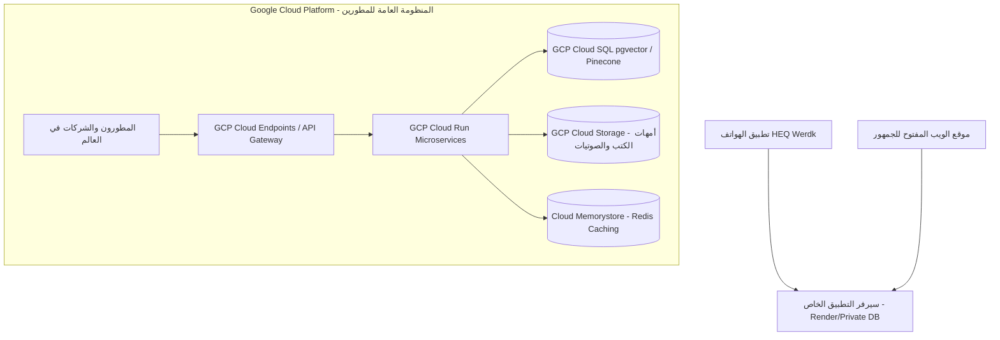

# وثيقة الرؤية المستقبلية: منصة HEQ Werdk كمرجع ومحرك تقني مفتوح للأمة
## (The Open Islamic Tech Ecosystem & Digital Waqf Roadmap)

> ### 📌 الوظائف والمهام الأساسية لهذا الملف (File Functions & Scope):
> * **الرؤية الاستراتيجية الكبرى:** توثيق تحويل المنصة إلى أكبر وقف تقني إسلامي ومصدر مفتوح لخدمة المطورين حول العالم.
> * **معمارية هيكلة البيانات المفتوحة:** تحديد المشاريع الخمسة لهيكلة كتب الحديث والسيرة والفقه والمتون والأسئلة (Flagship Datasets).
> * **معمارية السحابة والأمان (GCP Architecture):** فصل منظومة الإنتاج والتطبيق عن منظومة الـ APIs والمطورين العامة.
> * **خارطة طريق التنفيذ (Actionable Phases):** مراحل إطلاق المنصة ونشر مكتبات الـ SDKs المفتوحة.
> * **الفئة المستهدفة:** المطورون، المعماريون التقنيون، ونماذج الذكاء الاصطناعي المساهمة في بناء البيئة الإسلامية المفتوحة.

---

## 🌟 1. الرؤية الكبرى (The Grand Vision)
* جعل موقع **HEQ Werdk** المرجع الأول للمطورين ومصممي النماذج الذكية لبناء التطبيقات الإسلامية.
* إتاحة كافة المستودعات، الملفات المهيكلة (JSON)، برومبتات النماذج (System Prompts)، وهندسة المنطق الديني الموثوق مجاناً لوجه الله تعالى.
* فصل منظومة الإنتاج الخاصة بالتطبيق عن منظومة الـ APIs العامة المفتوحة للجمهور لضمان أعلى مستويات الأمان والاستقرار.

---

## 📚 2. رقمنة أمهات الكتب وربطها بالمتجهات (Classical Islamic Text & Vector Embeddings)

### أ. هيكلة كتب الحديث والفقه (Structured JSON Schemas)
تحويل أمهات الكتب (صحيح البخاري، صحيح مسلم، سنن أبي داود، الترمذي، كتب المذاهب الأربعة) من نصوص عادية إلى ملفات JSON فائقة الدقة تحتوي على:
* **رقم الحديث / المسألة العالمي.**
* **السند (Isnad):** مصفوفة الرواة مع تصنيفهم ورتبهم.
* **المتن (Matn):** النص الأصلي مشكولاً بالكامل.
* **التبويب (Chapter & Section):** الكتاب، الباب، والموضوع العام.
* **الحكم والتخريج (Grading & Takhrij):** درجة الصحة والتوثيق.

### ب. التضمينات والمتجهات للبحث الذكي (Vector Embeddings & RAG)
* توليد **تضمينات متجهة (Vector Embeddings)** لكل حديث ومسألة فقهية لتمكين أنظمة الذكاء الاصطناعي من إجراء بحث دلالي (Semantic Search) دقيق.
* استخدام قواعد بيانات متجهة (مثل **Pinecone**, **Qdrant**, أو **pgvector** على PostgreSQL / BigQuery) لتكون جاهزة لتقنيات الـ RAG (استرجاع المعلومات المعزز بالتوليد) لمنع هلوسة نماذج الذكاء الاصطناعي في الفتاوى والنصوص الدينية.

---

## 🤖 3. دليل الذكاء الاصطناعي الإسلامي (The Islamic AI Developer Kit)

* **دليل النماذج الموصى بها (Model Recommendations):**
  - ترشيح أفضل النماذج مفتوحة ومغلقة المصدر لمعالجة النصوص الإسلامية والتشكيل (مثل Claude 3.5 Sonnet للمنطق الدقيق، و Gemini Flash للسرعة ومعالجة الصوت والوسائط المتعددة).
* **مكتبة البرومبتات وقواعد السلامة الدينية (Prompts & Guardrails Library):**
  - ملفات Markdown جاهزة للتحميل تحتوي على:
    - برومبتات استخراج الفوائد والوقفات التدبرية من الآيات.
    - برومبتات توليد التحديات التعليمية (الاختبارات، الترتيب، الأسئلة التفاعلية).
    - برومبتات منع الهلوسة الدينية والتأكد من عزو الأقوال لأصحابها.

---

## ☁️ 4. معمارية البنية التحتية وفصل السيرفرات (Google Cloud Architecture)

### استراتيجية العزل والحماية (Isolation & Scalability):
1. **عزل سيرفر التطبيق:** يظل سيرفر تطبيقك وقاعدة بيانات المستخدمين (Render + Postgres الحالية) في شبكة خاصة معزولة تماماً لا يصل لها المطورون الخارجيون لحماية بيانات مستخدمي التطبيق وسرعة استجابتهم.
2. **سيرفر المطورين على Google Cloud (GCP):**
   - **GCP Cloud Run:** لتشغيل خوادم الـ APIs العامة كـ Containers تتوسع تلقائياً (Auto-scaling) من صفر حتى ملايين الطلبات، ولا تدفع إلا عند الاستخدام الفعلي.
   - **GCP Cloud Endpoints / API Gateway:** لإدارة مفاتيح الـ API للمطورين (API Keys) وتنظيم معدل الاستهلاك (Rate Limiting) لمنع الهجمات واستنزاف السيرفر.
   - **Redis Cache (Memorystore):** لتخزين الأحاديث والآيات الأكثر طلباً في الذاكرة اللحظية لتكون سرعة الرد للمطورين أقل من 15 مللي ثانية.

---

## 🚀 5. خارطة طريق التنفيذ (Actionable Phases)

### المرحلة الحالية (Focus 1: الانتهاء من الأساس):
* [x] إنهاء مسارات القرآن (11 جزءاً) والفقه (الصيام).
* [ ] إنهاء محرك ألعاب القرآن في فلاتر (Claude).
* [ ] إنهاء وتجهيز مسار السيرة النبوية والمشغل الصوتي.
* [ ] تجهيز الـ WebApp المفتوح ليكون واجهة الاستخدام الأساسية.

### المرحلة الثانية (الانطلاق العام للمطورين):
* [ ] إطلاق صفحة المطورين (Developers Hub) في الموقع وتوفير توثيق Swagger / Postman.
* [ ] نشر أول باقة من ملفات الـ JSON والبرومبتات للمجتمع البرمجي على GitHub تحت رخصة مفتوحة.

### المرحلة الثالثة (المنظومة السحابية الكبرى - Google Cloud):
* [ ] تجهيز خوادم الـ APIs المفتوحة على Google Cloud.
* [ ] رقمنة وضخ أمهات كتب الحديث المهيكلة مع التضمينات المتجهة (Vector DB).
* [ ] توفير SDKs برمجية (Flutter Package, NPM Package, Python SDK) ليسهل على أي مطور استدعاء مكتبة HEQ في كوده بسطرين فقط.

---

> **ملاحظة تاريخية:** تم توثيق هذه الرؤية في تاريخ 11 أكتوبر 2026، لتكون المرجع الثابت والمرشد المعماري عند الانتقال للخطوات التوسعية الكبرى بإذن الله.
